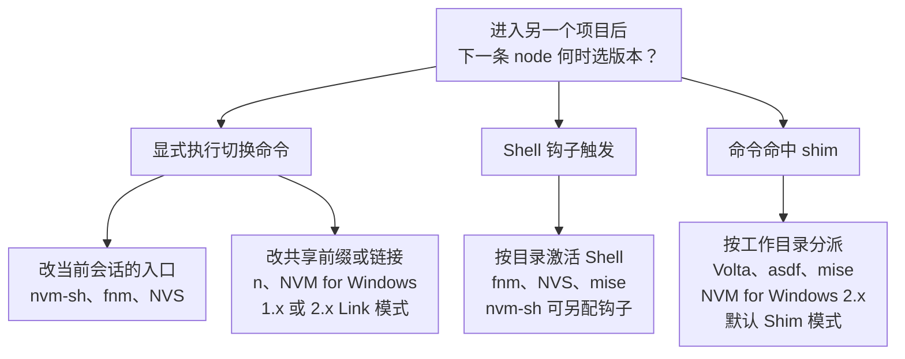

# 前端工具链版本管理：nvm、Volta 与替代方案

同一台机器上，一个旧项目需要 Node.js 22，新项目需要 Node.js 24。两个版本都装好了，但在新项目的终端里执行 `node -v` 仍得到 22，IDE 的构建任务甚至用了系统预装的版本。问题发生在**命令和可执行文件之间**。版本管理器负责在多个已安装版本中选出一个，并让当前执行入口实际用上它。工具之间最重要的区别，是**何时选择、依据什么选择，以及这次选择对哪些进程生效**。

对比按 **2026-11-25** 查证。关键版本分界包括 nvm-sh 0.41.0、fnm 1.39.0、NVM for Windows 1.2.2 和 2.0.1、Volta 2.0.2、`n` 10.2.0、NVS 1.7.1，以及 pnpm 10.x 和 11.x。表中的能力条件以相应版本的文档、发行记录或源码为依据。

## 1. 从一条 `node` 命令拆开声明、选择与执行

一个版本管理方案要经过三个环节。缺哪一步，就沿着哪一步查。

1. **声明**。仓库写下意图，例如 `.nvmrc` 里的 `24.11.1`。还要知道哪个工具会读这个文件、从哪个目录开始找、版本别名何时解析。
2. **选择**。管理器把声明解析成一个具体版本，查找本地安装，必要时再从上游下载安装。允许一个版本范围和锁定某个发布版本，在这一环节产生不同结果。
3. **执行**。Shell 按命令查找规则定位入口，入口可能是 Node 本体，也可能是链接或一个转发程序。Node 启动后，`process.execPath` 报告实际启动它的可执行文件的绝对路径，并解析符号链接。两处观测连起来，才知道版本选择是否真正抵达了进程。 [PowerShell 命令优先级](https://learn.microsoft.com/en-us/powershell/module/microsoft.powershell.core/about/about_command_precedence) · [Node.js 22 进程 API](https://nodejs.org/docs/latest-v22.x/api/process.html#processexecpath)

进入项目目录会改变当前工作目录。要让版本随之改变，还需要有程序读取声明并落实它。nvm-sh 的 `nvm use` 更新当前 Shell 的 `PATH`，按原有路径的情况前置目标版本的 `bin`，或就地替换旧版本的条目，然后刷新 Shell 的命令查找缓存。已启动的进程继续使用它原先的可执行文件与环境，随后启动的子进程才会继承新的 `PATH`。Volta 先让命令命中一个稳定的 shim，再由 shim 在每次执行时根据项目上下文选择实际的 Node。 [nvm-sh 0.41.0 的路径更新规则](https://github.com/nvm-sh/nvm/blob/v0.41.0/nvm.sh#L1619-L1650) · [`nvm use` 实现](https://github.com/nvm-sh/nvm/blob/v0.41.0/nvm.sh#L5900-L5918) · [Volta 工作原理](https://docs.volta.sh/guide/#how-does-it-work)

**实测**。在 WSL 的 Ubuntu 22.04.2 和 Bash 5.1.16 中，加载 nvm-sh 0.41.0，使用独立的 `NVM_DIR`，两个临时项目分别声明 `22.16.0` 和 `24.11.1`。在项目 A 执行 `nvm use` 后得到 22.16.0。切到 B 后仍为 22.16.0。在 B 的子 Shell 执行 `nvm use` 后，子 Shell 及它启动的 Bash 得到 24.11.1，退出子 Shell 后，父 Shell 仍为 22.16.0。在父 Shell 再执行一次 `nvm use`，结果才变为 24.11.1。每一步的 `command -v node` 和 `process.execPath` 都指向对应版本。

Windows PowerShell 7.6.9 上也观察到两个 Node 入口。只交换当前测试进程里两条 `PATH` 记录的顺序，`Get-Command node -All` 的首项和实际运行的 Node 同时改变。若 IDE 通过自己的环境变量启动子进程，或者直接配置 Node 的绝对路径，排查时就应检查 IDE 实际启动的命令。

## 2. 八款工具对比

### 2.1 对比图展示版本何时生效

沿图从上到下，就能看到切到另一个项目后，下一条 `node` 命令何时选定版本。有多种入口的工具会出现在多条分支中。

左侧的两个分支都可以表现为一次 `use`，影响范围却不同。会话级切换适合同时开两个终端维护不同项目。共用一条链接或安装前缀时，另一个终端下一次命中该入口也会受到切换影响。Shell 钩子依赖启动脚本和触发时机。shim 把选择推迟到每次命令调用，前提是启动方能找到 shim，且调用时的工作目录符合预期。

### 2.2 逐项比较解决的问题和代价

表中的「包管理器」指能否选择 **npm、Yarn 或 pnpm 自己的版本**。Node 发行包自带的 npm 可能随 Node 版本一起改变，这是另一种绑定关系。

| 工具与平台 | 主要解决的问题 | 声明位置与生效方式 | 包管理器能力 | 主要局限与依据 |
| --- | --- | --- | --- | --- |
| **nvm-sh** · macOS、Linux、WSL | 在同一台机器上为不同终端保留不同的 Node 版本 | `.nvmrc` → `nvm use` 改写当前 Shell 的 `PATH`。可另配切目录钩子 | 随 Node 选到其安装目录里的 npm | 每个调用入口要加载 nvm 或继承已激活的环境。切目录默认会保留旧版本。 [nvm-sh 0.41.0 文档](https://github.com/nvm-sh/nvm/tree/v0.41.0#deeper-shell-integration) |
| **NVM for Windows** · 原生 Windows | 在 Windows 上管理多套 Node，并向终端提供稳定的命令入口 | 1.x 更新共享符号链接。2.x 默认 Shim 模式执行时按项目解析，可读 `.nvmrc`、`.node-version` 等，也保留手动切换共享入口的 Link 模式 | 2.x Shim 模式有包管理器代理，可检查声明与实际包管理器是否匹配 | 旧版切换作用于共用链接的终端。2.0.1 的 shim 自动选择基于当前目录，默认关闭缺失版本的自动安装。 [1.2.2 文档](https://github.com/nvm-windows/nvm/blob/1.2.2/README.md) · [2.0.1 模式对照](https://docs.nvm-windows.com/features/modes/) · [默认配置源码](https://github.com/nvm-windows/common/blob/e92b67d855c1f697cfc695535b85cdb0e7973d96/settings/options.go#L4-L18) · [目录查找源码](https://github.com/nvm-windows/shim/blob/bc2e1d9648c4104f9504482dc8a7ae51ed09718b/shared/nodeversion.zig#L505-L534) |
| **fnm** · macOS、Linux、Windows | 在跨平台项目间快速切换 Node，并沿用常见版本文件 | 1.39.0 在查找的每层优先读 `.nvmrc`，其次 `.node-version`，最后 `engines.node`。默认查当前目录，递归查找可配置。初始化为 Shell 建立独立链接，`--use-on-cd` 启用切目录触发 | 通过选中的 Node 安装目录使用其 npm | 自动切换依赖 Shell 钩子。1.39.0 的 PowerShell 集成通过重新绑定 `cd` 触发，直接执行 `Set-Location` 会绕过这个入口。 [选择顺序](https://github.com/Schniz/fnm/blob/v1.39.0/src/version_files.rs) · [Shell 初始化](https://github.com/Schniz/fnm/blob/v1.39.0/src/commands/env.rs#L31-L52) · [PowerShell 钩子](https://github.com/Schniz/fnm/blob/v1.39.0/src/shell/powershell.rs#L28-L51) |
| **`n`** · macOS、Linux、WSL | 维持一个简单的活动安装，同时缓存多个版本 | 普通切换覆盖安装前缀里的活动版本。可显式执行 `n auto` 读取项目版本，或用 `n exec` 为一条命令选择版本 | 默认安装随发行包来的 npm，可设为保留前缀内已有的 npm | 安装前缀必须可写。两个终端共用一个前缀时，普通切换会影响两边。 [`n` 10.2.0 文档](https://github.com/tj/n/blob/v10.2.0/README.md#how-it-works) |
| **NVS** · macOS、Linux、Windows | 按会话切换版本，也支持选择不同的下载源及 CPU 架构 | `nvs use` 设置当前 Shell 的 `PATH`。通过 `nvs auto on` 可按 `.node-version` 或 `.nvmrc` 自动切换。还可显式设置默认版本 | 随 Node 使用其 npm，并提供迁移全局包的命令 | 自动切换支持 Bash 和 PowerShell 等 Shell，Windows CMD 缺少此能力。 [NVS 1.7.1 文档](https://github.com/jasongin/nvs/blob/v1.7.1/README.md#automatic-switching-per-directory) |
| **Volta** · macOS、Linux、Windows | 在项目里一起固定 Node 和包管理器，并为全局安装的 JS CLI 保留它自己的 Node | `volta pin` 写入 `package.json` 的 `volta` 字段。命令命中 shim 后按当前项目配置或用户默认值分发 | 可独立固定 npm、Yarn。2.0.2 的 pnpm 支持需要启用实验开关 `VOLTA_FEATURE_PNPM`，全局安装还有额外限制 | 维护者已公开宣布停止维护，并建议迁移到 mise。迁移时还要核对全局 CLI 的运行时约束。 [Volta 项目与工具链](https://docs.volta.sh/guide/understanding) · [pnpm 限制](https://docs.volta.sh/advanced/pnpm) · [维护公告](https://github.com/volta-cli/volta/issues/2080) |
| **asdf** · macOS、Linux、WSL | 用同一份仓库配置管理 Node、Ruby、Python 等工具 | `.tool-versions` + shim，Node 的安装交给 `asdf-nodejs` 插件。可启用旧版本文件支持 | Node 插件可预装全局 npm 包。新安装的 CLI 可能需要 `asdf reshim` 才能从 shim 路径调用 | 团队须管理插件及其安装依赖。Node 插件的 `.tool-versions` 不接受模糊版本或 LTS 代号。 [asdf shim 管理](https://asdf-vm.com/manage/core.html#reshim) · [Node 插件的版本规则](https://github.com/asdf-vm/asdf-nodejs#partial-and-codename-versions) |
| **mise** · macOS、Linux、Windows | 为多语言仓库同时声明运行时、CLI 和任务所需的环境 | `mise.toml` 或 `.tool-versions`。交互 Shell 可用 `activate`，IDE 可配置 shim 路径，无人值守入口可用 `mise exec` | 能单独固定 npm，也可配置 pnpm、Yarn，或显式启用读取相应的 `package.json` 字段 | 从 nvm 迁移时，需要显式启用 Node 的 `.nvmrc` 或 `.node-version` 等文件支持。shim 主要负责可执行文件分派，任务及环境变量需要按入口配置。 [mise 的 shim](https://mise.jdx.dev/dev-tools/shims.html) · [Node 与包管理器配置](https://mise.jdx.dev/lang/node.html#version-files) |

`fnm` 会给每次 Shell 初始化建立独立的链接，旧版 NVM for Windows 则在多个终端之间共享活动链接。两种机制在两个终端同时维护不同项目时会产生不同结果。shim 把选择留到命令调用时，但若 Shell 优先命中旧的系统安装，或 IDE 直接启动另一个 Node，项目里的 shim 规则就没有机会生效。版本管理器迁移要逐个核对终端、IDE、脚本和 CI 的实际入口。 [fnm 初始化实现](https://github.com/Schniz/fnm/blob/v1.39.0/src/commands/env.rs#L31-L52) · [NVM for Windows 模式对照](https://docs.nvm-windows.com/features/modes/) · [mise 的 IDE 设置](https://mise.jdx.dev/ide-integration.html)

在 WSL Bash 的同一组项目中，用已准备好 Node 的版本缓存复测了两种自动切换方式。fnm 1.39.0 启用 `--use-on-cd` 后，交互 Shell 的 `command -v node` 在两个目录中输出相同的会话入口，但链接的目标随 `cd` 改变，Node 从 22.16.0 切到 24.11.1。默认的非交互 Bash 缺少别名展开，同一次 `cd` 后仍是 22.16.0。Volta 2.0.2 的两个项目则使用同一个 shim，继承相同的 `PATH`，分别调用 `node` 就得到各自固定的版本，`volta which node` 也指向不同二进制。 [fnm 的 Bash 切换钩子](https://github.com/Schniz/fnm/blob/v1.39.0/src/shell/bash.rs#L29-L55) · [Volta 项目工具链](https://docs.volta.sh/guide/understanding)

## 3. Node 选对以后，包管理器和依赖如何固定

同一份 `package.json` 可以同时表达兼容范围、开发工具约束和包管理器版本。**真正决定行为的是读取该字段的程序及其版本。**

| 声明或工具 | 谁处理 | 什么时候生效 |
| --- | --- | --- |
| `engines.node` | npm、部分 Node 管理器和 CI 动作 | 对 npm 通常是兼容性约束，是否拒绝安装取决于配置。fnm 1.39.0 还可把它作为版本选择的回退来源。 [npm 的 `engines`](https://docs.npmjs.com/files/package.json/#engines) · [fnm 版本文件实现](https://github.com/Schniz/fnm/blob/v1.39.0/src/version_files.rs) |
| `devEngines` | npm CLI 11 | 在 `install`、`ci`、`run` 前检查当前工具，按规则报错、警告或忽略。执行检查时 Node 和 npm 已经启动。 [npm 11 的 `devEngines`](https://docs.npmjs.com/cli/v11/configuring-npm/package-json/#devengines) |
| `packageManager` 与 Corepack | 命中 Corepack shim 时由 Corepack 处理 | shim 按项目声明选择包管理器版本，并按需下载。通常启用 Yarn 和 pnpm 的 shim，npm 的 shim 需要显式启用。Node.js **25 起停止随官方发行版分发 Corepack**，仍可另行安装兼容版本。 [Corepack 0.34.7 文档](https://github.com/nodejs/corepack/blob/v0.34.7/README.md#corepack-enable--name) · [Node.js 25 文档](https://nodejs.org/docs/latest-v25.x/api/corepack.html) |
| `packageManager` 与 pnpm 自管理 | 已经启动的 pnpm | pnpm 10 用 `managePackageManagerVersions` 控制是否按项目声明下载并运行对应的 pnpm。pnpm 11 改用 `pmOnFail`，默认采用下载策略，仍要为执行入口准备可启动的 pnpm。 [pnpm 10 设置](https://pnpm.io/10.x/settings#managepackagemanagerversions) · [pnpm 11 发行说明](https://github.com/pnpm/pnpm/releases/tag/v11.0.0#package-manager-settings) |
| `devEngines.runtime` 与 pnpm | pnpm 10.14 起支持 | 可下载项目运行时，把解析出的版本和校验值写进锁文件，并让项目脚本用这个运行时。以 pnpm 10.x 为例，在同一项目直接从 Shell 执行 `node`，仍应查看 Shell 实际命中的入口。 [pnpm 10.x 的运行时声明](https://pnpm.io/10.x/package_json#devenginesruntime) |
| 依赖锁文件 | 项目包管理器 | 固定依赖解析结果。以 `npm ci` 为例，清单与锁文件不匹配就失败，影响依赖树的 npm 设置也要保持一致。 [npm 11 的 `npm ci`](https://docs.npmjs.com/cli/v11/commands/npm-ci/) |

这里的引导顺序很关键。假设仓库写了 `"packageManager": "pnpm@10.33.0"`。Shell 首先得找到一个 `pnpm` 入口。若命中 Corepack 的 shim，Corepack 执行选择。若命中已装的 pnpm，当前 pnpm 才有机会执行自己的版本切换。锁文件被读取时，负责解释它的工具已经被选定。离线 CI 中，即使最终版本写得很精确，也要给引导程序、目标工具及依赖准备相应的缓存或制品。 [Corepack 离线工作流](https://github.com/nodejs/corepack/blob/v0.34.7/README.md#offline-workflow) · [pnpm 10 设置](https://pnpm.io/10.x/settings#managepackagemanagerversions)

在 Windows PowerShell 7.6.9 的临时项目中，pnpm 10.21.0 从 Node 22.16.0 启动。项目声明 `devEngines.runtime` 为 Node 24.11.1 且 `onFail` 为 `download`，安装后锁文件记录了该版本及校验信息。同一个 Shell 里，直接运行 `node` 得到 22.16.0，经 `pnpm run` 执行项目脚本得到 24.11.1。用 npm 11.6.2 测试其检查机制时，要求另一个 Node 版本并设为 `error` 会在项目脚本启动前退出，设为 `warn` 则发出警告并继续使用当前 Node。

Corepack 0.34.7 的临时安装也验证了引导差异。默认的 `corepack enable` 生成 Yarn 和 pnpm 的命令入口。已有的 npm 11.6.2 可直接运行。显式执行 `corepack npm --version` 时，Corepack 按项目声明选择 npm 11.6.1，在空缓存且禁用下载的条件下停在获取该版本的一步。

## 4. 团队怎么选，以及怎样查本地与 CI 的差异

### 4.1 按需要复现的范围选工具

- **个人维护多个 Node 项目**。主要决策是手动切换是否足够、两个终端能否独立工作、是否需要原生 Windows。已有 `.nvmrc` 的 Unix 或 WSL 项目可从 nvm-sh 开始。团队跨 macOS、Linux 和 Windows，想沿用版本文件并在切目录时自动激活，可以比较 fnm 与 NVS。主要在 Windows 上工作且希望按调用选择时，要核对自己安装的 NVM for Windows 主版本和运行模式。 [nvm-sh](https://github.com/nvm-sh/nvm/tree/v0.41.0#about) · [fnm 1.39.0 命令文档](https://github.com/Schniz/fnm/blob/v1.39.0/docs/commands.md) · [NVM for Windows 模式](https://docs.nvm-windows.com/features/modes/)
- **跨平台团队固定整套项目工具链**。如果仓库还要固定 Python、Ruby 或独立 CLI，比较 asdf 的插件模式与 mise 的显式执行入口。用一个项目文件作为约定，检查每个本地入口和 CI 对这个文件的真实解析规则。Volta 存量项目迁移时，可先盘点 `volta.node`、独立固定的 npm 或 Yarn、`volta.extends` 和全局 CLI，再逐项核对替代工具能否覆盖。 [asdf 版本文档](https://asdf-vm.com/manage/versions.html) · [mise 版本文件](https://mise.jdx.dev/dev-tools/versions.html) · [Volta 工作区配置](https://docs.volta.sh/advanced/workspaces#extending-the-configuration)
- **原生依赖和编译环境也要一致**。容器把系统库、编译器、Node 和包管理器一起带入可描述的环境。官方 Node 镜像里，Debian 系列使用 glibc，Alpine 使用 musl。同一个 Node 版本和依赖锁文件，仍可能让原生插件选择不同的预编译包、触发现场编译或加载失败。Node-API 的 ABI 稳定承诺有边界，插件依赖的外部系统库也要满足要求。固定镜像摘要能固定基础镜像输入，后续网络安装、目标平台及构建参数仍需各自约束。 [Node 官方镜像的 Alpine 说明](https://github.com/nodejs/docker-node#nodealpine) · [Node.js 22 的 Node-API ABI 边界](https://nodejs.org/docs/latest-v22.x/api/n-api.html#implications-of-abi-stability) · [Docker 镜像版本固定](https://docs.docker.com/build/building/best-practices/#pin-base-image-versions)

### 4.2 同一份文件交给不同的程序，结果可能不同

GitHub Actions 的 `setup-node` 7.1.0 同时收到 `node-version` 和 `node-version-file` 时，优先使用前者。若以 `package.json` 为版本文件，动作依次读取 `volta.node`、针对 Node 的 `devEngines.runtime`、`engines.node`，再尝试递归读取 `volta.extends` 指向的文件。假设迁移后 `.nvmrc` 写了 24，旧的 `volta.node` 还写着 22，本地的 fnm 会先读 `.nvmrc`，从 `package.json` 取版本的 CI 就可能继续用 22。该动作可缓存包管理器的下载数据，安装步骤仍负责生成 `node_modules`。 [setup-node 7.1.0 参数解析](https://github.com/actions/setup-node/blob/v7.1.0/src/main.ts#L108-L134) · [版本文件解析](https://github.com/actions/setup-node/blob/v7.1.0/src/util.ts#L12-L56) · [缓存说明](https://github.com/actions/setup-node/blob/v7.1.0/README.md#caching-global-packages-data) · [fnm 1.39.0 的查找顺序](https://github.com/Schniz/fnm/blob/v1.39.0/src/version_files.rs)

遇到差异时，应在**失败的那个入口里**采集信息。先记录工作目录和 `Get-Command node -All`（PowerShell）或 `command -v node`（Bash），再执行 `node -p 'JSON.stringify({node:process.version,exe:process.execPath,os:process.platform,arch:process.arch,abi:process.versions.modules})'`。接着记录实际使用的包管理器版本，并顺着其入口检查 shim、版本文件与覆盖项。若这些一致，再核对缓存中有没有复用异构平台生成的 `node_modules`，以及运行镜像、系统库、原生模块 ABI（应用二进制接口）和安装参数是否一致。 [Node.js 22 进程 API](https://nodejs.org/docs/latest-v22.x/api/process.html#processversions) · [npm 11 的 `npm ci`](https://docs.npmjs.com/cli/v11/commands/npm-ci/)

**验证范围**。Windows PowerShell 实测涵盖命令查找、npm 的环境检查、Corepack 的引导和 pnpm 的项目运行时。WSL Bash 实测了 nvm-sh、fnm 和 Volta 在本地已有目标版本时的激活与分派。其余工具的行为，以及原生 macOS、GitHub runner、容器和原生插件案例依据官方文档、源码或发行说明分析。
